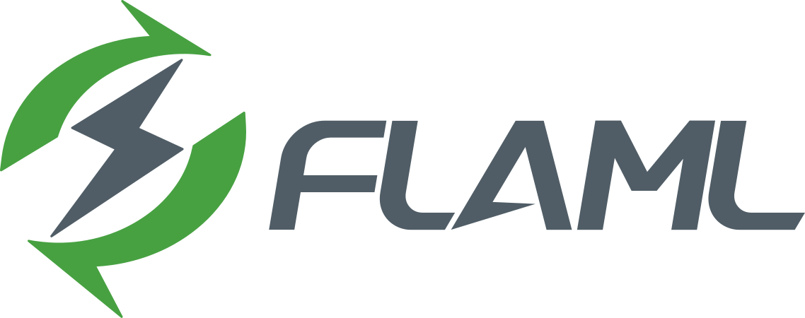

[](https://badge.fury.io/py/FLAML)

[](https://github.com/microsoft/FLAML/actions/workflows/python-package.yml)
[](https://pypi.org/project/FLAML/)
[](https://pepy.tech/project/flaml)
[](https://discord.gg/Cppx2vSPVP)

<!-- [](https://gitter.im/FLAMLer/community?utm_source=badge&utm_medium=badge&utm_campaign=pr-badge&utm_content=badge) -->

# 快速且高效的自動化機器學習與超參數調整函式庫

<p align="center">
    
    <br>
</p>

<p align="center">
  <a href="https://github.com/microsoft/FLAML/blob/main/README.md">English</a> · <a href="https://github.com/microsoft/FLAML/blob/main/README.zh.md">简体中文</a> · <b>繁體中文</b>
</p>

:fire: FLAML 支援在 [Microsoft Fabric Data Science](https://learn.microsoft.com/en-us/fabric/data-science/automated-machine-learning-fabric) 中進行 AutoML 與超參數調整。此外，承蒙 Microsoft Fabric 產品團隊的貢獻，我們新增了對 Python 3.11+ 的支援、一系列新的估計器（estimator），以及與 MLflow 的完整整合。

:fire: 重要提醒：[AutoGen](https://microsoft.github.io/autogen/) 已搬到專屬的 [GitHub 儲存庫](https://github.com/microsoft/autogen)。FLAML 不再包含 `autogen` 模組，請直接使用 AutoGen。

## 什麼是 FLAML

FLAML 是一個輕量的 Python 函式庫，能有效率地自動化機器學習與 AI 作業。它可以自動化以大型語言模型、機器學習模型等為基礎的工作流程，並將其效能最佳化。

- FLAML 讓 ML/AI 工作流程的自動化與調整更節省成本，包括在資源受限的情況下進行模型選擇與超參數最佳化。
- 對於分類、迴歸等常見的機器學習任務，它能以很少的運算資源，為使用者提供的資料快速找到品質良好的模型。它容易客製化或擴充，使用者可以在平滑的範圍內找到所需的客製化程度。
- 它支援快速且節省成本的自動調整（例如：基礎模型的推論超參數、MLOps/LMOps 工作流程中的設定、管線、數學／統計模型、演算法、運算實驗、軟體設定），能處理評估成本不一、且具有複雜限制／引導／提前停止條件的大型搜尋空間。

FLAML 以一系列[研究成果](https://microsoft.github.io/FLAML/docs/Research/)為基礎，這些研究來自 Microsoft Research，以及賓州州立大學、史蒂文斯理工學院、華盛頓大學、滑鐵盧大學等合作夥伴。

FLAML 在 [ML.NET](http://dot.net/ml) 中有 .NET 實作；ML.NET 是 .NET 的開源跨平台機器學習框架。

## 安裝

最新版的 FLAML 需要 **Python >= 3.10 且 < 3.14**。其他 Python 版本可能也能執行核心元件，但無法保證完整支援所有模型。可以透過 `pip` 安裝 FLAML：

```bash
pip install flaml
```

不加額外選項時，只會安裝最精簡的相依套件。你可以依需要的功能安裝額外選項，例如使用以下指令安裝 [`automl`](https://microsoft.github.io/FLAML/docs/Use-Cases/Task-Oriented-AutoML) 模組所需的相依套件。

```bash
pip install "flaml[automl]"
```

更多選項請見[安裝說明](https://microsoft.github.io/FLAML/docs/Installation)。
每個 [`notebook 範例`](https://github.com/microsoft/FLAML/tree/main/notebook) 可能需要安裝特定的選項。

## 快速開始

- 只要三行程式碼，就能開始使用這個節省成本又快速的 AutoML 引擎，它是 [scikit-learn 風格的估計器](https://microsoft.github.io/FLAML/docs/Use-Cases/Task-Oriented-AutoML)。

```python
from flaml import AutoML

automl = AutoML()
automl.fit(X_train, y_train, task="classification")
```

- 你可以限制要使用的學習器，把 FLAML 當作 XGBoost、LightGBM、Random Forest 等的快速超參數調整工具，或用於[自訂學習器](https://microsoft.github.io/FLAML/docs/Use-Cases/Task-Oriented-AutoML#estimator-and-search-space)。

```python
automl.fit(X_train, y_train, task="classification", estimator_list=["lgbm"])
```

- 你也可以對[自訂函式](https://microsoft.github.io/FLAML/docs/Use-Cases/Tune-User-Defined-Function)執行一般的超參數調整。

```python
from flaml import tune

tune.run(
    evaluation_function, config={...}, low_cost_partial_config={...}, time_budget_s=3600
)
```

- [Zero-shot AutoML](https://microsoft.github.io/FLAML/docs/Use-Cases/Zero-Shot-AutoML) 讓你沿用 lightgbm、xgboost 等既有的訓練 API，同時享有 AutoML 的好處：針對每個任務挑選高效能的超參數組合。

```python
from flaml.default import LGBMRegressor

# Use LGBMRegressor in the same way as you use lightgbm.LGBMRegressor.
estimator = LGBMRegressor()
# The hyperparameters are automatically set according to the training data.
estimator.fit(X_train, y_train)
```

## 文件

你可以在[這裡](https://microsoft.github.io/FLAML/)找到 FLAML 的詳細文件。

此外，你還可以找到：

- FLAML 相關的[研究](https://microsoft.github.io/FLAML/docs/Research)與[部落格文章](https://microsoft.github.io/FLAML/blog)。

- [Discord](https://discord.gg/Cppx2vSPVP)。

- [貢獻指南](https://microsoft.github.io/FLAML/docs/Contribute)。

- ML.NET 的文件與教學：[Model Builder](https://learn.microsoft.com/dotnet/machine-learning/tutorials/predict-prices-with-model-builder)、[ML.NET CLI](https://learn.microsoft.com/dotnet/machine-learning/tutorials/sentiment-analysis-cli)、[AutoML API](https://learn.microsoft.com/dotnet/machine-learning/how-to-guides/how-to-use-the-automl-api)。

## 參與貢獻

本專案歡迎各種貢獻與建議。多數貢獻需要你同意《貢獻者授權協議》（Contributor License Agreement，CLA），聲明你有權、且確實授予我們使用你所貢獻內容的權利。詳情請見 <https://cla.opensource.microsoft.com>。

如果你剛接觸 GitHub，[這裡](https://docs.github.com/en/pull-requests/collaborating-with-pull-requests) 有詳細的說明，介紹如何參與 GitHub 上的開發。

當你提交 pull request 時，CLA 機器人會自動判斷你是否需要提供 CLA，並在 PR 上做出適當標示（例如狀態檢查、留言）。只要依照機器人的指示操作即可。在所有使用我們 CLA 的儲存庫中，你只需要完成一次。

本專案已採用[微軟開源行為準則](https://opensource.microsoft.com/codeofconduct/)。
更多資訊請見[行為準則常見問題](https://opensource.microsoft.com/codeofconduct/faq/)，或
聯絡 [opencode@microsoft.com](mailto:opencode@microsoft.com) 提出任何問題或意見。

## 貢獻者牆

<a href="https://github.com/microsoft/flaml/graphs/contributors">
  
</a>
